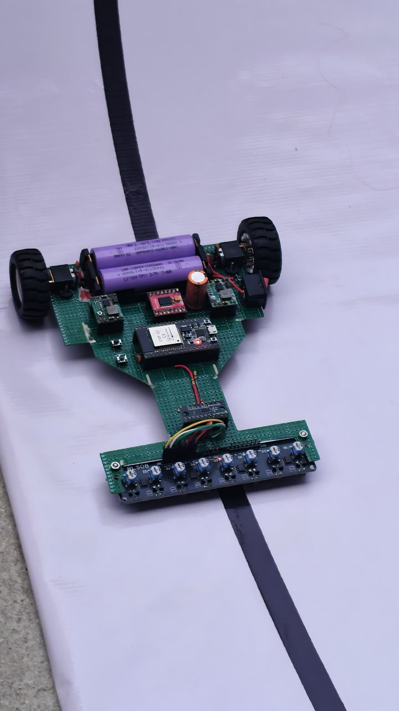
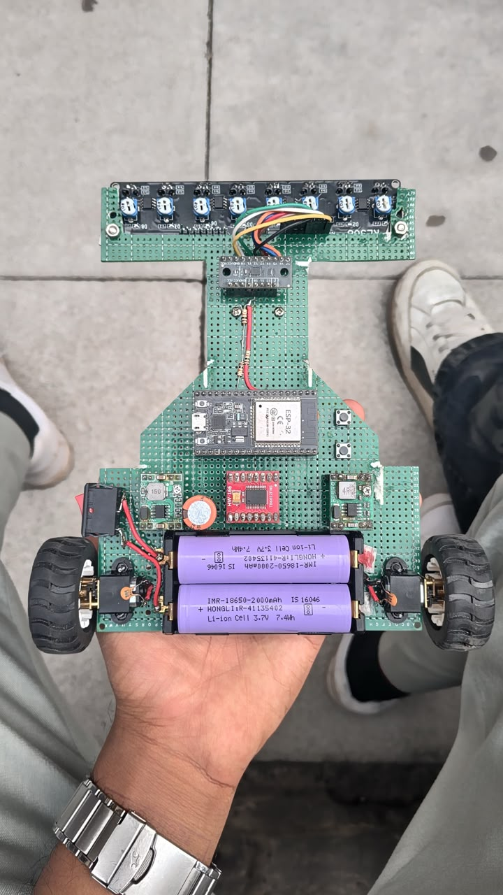

<div align="center">
<samp><b>HIGH-SPEED PID LINE FOLLOWER ROBOT</b></samp>

<samp>esp32 · c/c++ · pid · robotics · embedded systems</samp>

</div>

---

<div align="center"><samp>A high-speed line follower robot built using an ESP32 NodeMCU and an 8-array IR sensor. The robot uses a Proportional-Integral-Derivative (PID) control algorithm to achieve smooth, responsive, and accurate line tracking at high speeds.</samp></div>

---

<div align="center">
<samp><b>Project Overview</b></samp>
</div>

<samp>This project implements a high-speed autonomous line-following robot using an ESP32 as the main controller.</samp>

<samp>An 8-array IR sensor continuously detects the position of the line. The ESP32 processes the sensor readings, calculates the tracking error, and uses a PID controller to dynamically adjust the speed of the two motors.</samp>

<samp>The system is designed to maintain stable tracking while handling curves and sharp turns at relatively high speeds.</samp>

<samp>The project provides practical experience with:</samp>

- <samp>Embedded systems</samp>
- <samp>PID control</samp>
- <samp>Sensor-based navigation</samp>
- <samp>Motor control</samp>
- <samp>Real-time data processing</samp>
- <samp>Autonomous robotics</samp>

---

<div align="center">
<samp><b>Project Images</b></samp>
</div>

<table align="center">
<tr><th><samp>Robot</samp></th><th><samp>Chassis</samp></th></tr>
<tr><td></td><td></td></tr>
</table>

<div align="center">

</div>

---

<div align="center">
<samp><b>Features</b></samp>
</div>

- <samp>PID-based line tracking</samp>
- <samp>High-speed operation</samp>
- <samp>ESP32-based control system</samp>
- <samp>8-array IR sensor input</samp>
- <samp>Responsive correction for line deviations</samp>
- <samp>Support for sharp turns</samp>
- <samp>Adjustable PID parameters</samp>
- <samp>Analog sensor-based position detection</samp>
- <samp>Dual DC motor control</samp>

---

<div align="center">
<samp><b>Hardware Components</b></samp>
</div>

<table align="center">
<tr><th><samp>Component</samp></th><th><samp>Quantity</samp></th></tr>
<tr><td><samp>ESP32 NodeMCU</samp></td><td><samp>1</samp></td></tr>
<tr><td><samp>TB6612FNG Motor Driver</samp></td><td><samp>1</samp></td></tr>
<tr><td><samp>8-Array IR Sensor</samp></td><td><samp>1</samp></td></tr>
<tr><td><samp>Smart ELX RLS08 Sensor Board</samp></td><td><samp>1</samp></td></tr>
<tr><td><samp>Smart ELX 8-Channel Multiplexer</samp></td><td><samp>1</samp></td></tr>
<tr><td><samp>N20 DC Gear Motors</samp></td><td><samp>2</samp></td></tr>
<tr><td><samp>Wheels</samp></td><td><samp>2</samp></td></tr>
<tr><td><samp>Caster Wheel</samp></td><td><samp>1</samp></td></tr>
<tr><td><samp>3.7V Li-ion Batteries</samp></td><td><samp>2</samp></td></tr>
<tr><td><samp>MP1584 Buck Converter</samp></td><td><samp>1</samp></td></tr>
<tr><td><samp>HW133A Buck Converter</samp></td><td><samp>1</samp></td></tr>
<tr><td><samp>Push Buttons</samp></td><td><samp>2</samp></td></tr>
<tr><td><samp>Capacitors</samp></td><td><samp>As required</samp></td></tr>
<tr><td><samp>Connecting Wires and Chassis</samp></td><td><samp>1 set</samp></td></tr>
</table>

<samp>The detailed component list is also available in <a href="components">components</a>.</samp>

---

<div align="center">
<samp><b>PID Configuration</b></samp>
</div>

<samp>The current PID parameters used by <code>code.ino</code> are:</samp>

```cpp
Kp = 105.0;
Ki = 0.02;
Kd = 2.5;
```

<samp>These parameters determine how aggressively the robot responds to deviations from the line.</samp>

<samp>The values may need to be adjusted depending on:</samp>

- <samp>Track surface</samp>
- <samp>Line width</samp>
- <samp>Sensor positioning</samp>
- <samp>Motor characteristics</samp>
- <samp>Battery voltage</samp>
- <samp>Desired operating speed</samp>

<div align="center">
<samp><b>PID Terms</b></samp>
</div>

<table align="center">
<tr><th><samp>Parameter</samp></th><th><samp>Function</samp></th></tr>
<tr><td><samp>Kp</samp></td><td><samp>Controls the response to the current error</samp></td></tr>
<tr><td><samp>Ki</samp></td><td><samp>Accounts for accumulated error over time</samp></td></tr>
<tr><td><samp>Kd</samp></td><td><samp>Predicts and reduces rapid changes in error</samp></td></tr>
</table>

---

<div align="center">
<samp><b>Wiring</b></samp>
</div>

<samp>The complete wiring diagram is provided below.</samp>

<div align="center"></div>

---

<div align="center"><samp><b>ESP32 GPIO Mapping</b></samp></div>

<table align="center">
<tr><th><samp>Signal</samp></th><th><samp>ESP32 GPIO</samp></th></tr>
<tr><td><samp>TB6612FNG PWMA / AIN1 / AIN2</samp></td><td><samp>4 / 17 / 16</samp></td></tr>
<tr><td><samp>TB6612FNG PWMB / BIN1 / BIN2</samp></td><td><samp>21 / 18 / 19</samp></td></tr>
<tr><td><samp>TB6612FNG STBY</samp></td><td><samp>5</samp></td></tr>
<tr><td><samp>Multiplexer S0 / S1 / S2</samp></td><td><samp>27 / 26 / 25</samp></td></tr>
<tr><td><samp>Multiplexer analog signal</samp></td><td><samp>33</samp></td></tr>
<tr><td><samp>Start button / Calibration button / Status LED</samp></td><td><samp>13 / 14 / 2</samp></td></tr>
</table>

<samp>Multiplexer channels are read left-to-right in reverse sensor numbering: channel 0 is sensor 8 (leftmost, weight 0), and channel 7 is sensor 1 (rightmost, weight 7000). Confirm the sensor output voltage is within the ESP32 ADC range before connecting it; a 5 V analog output must be scaled to at most 3.3 V.</samp>

<div align="center"><samp><b>Button Workflow</b></samp></div>

- <samp><b>CALIB (GPIO 14):</b> while stopped, press the calibration button and move the sensor array so every sensor sees both the line and the background during the five-second calibration window.</samp>
- <samp><b>START (GPIO 13):</b> starts or stops the robot. Starting is blocked until every sensor reports a usable calibration range.</samp>
- <samp><b>Status LED (GPIO 2):</b> blinks during calibration, stays on after successful calibration, and stays off when calibration fails.</samp>
- <samp>Both buttons use internal pull-ups and are active-low; connect each button between its GPIO and GND.</samp>

---

<div align="center">
<samp><b>Repository Structure</b></samp>
</div>

```text
line-follower/
│
├── images/
│   ├── pic1.jpeg
│   └── pic2.jpeg
├── components
├── README.md
├── chasis.jpeg
├── code.ino
└── wiring.jpeg
```

<samp>The repository keeps project photos in <code>images/</code>, while the chassis photo and wiring diagram remain at the project root.</samp>

---

<div align="center">
<samp><b>Getting Started</b></samp>
</div>

<samp><b>Prerequisites</b></samp>

<samp>Before setting up the project, ensure that you have:</samp>

- <samp>Arduino IDE</samp>
- <samp>ESP32 board support package</samp>
- <samp>ESP32 NodeMCU</samp>
- <samp>Required sensors and motor components</samp>
- <samp>Appropriate power supply</samp>
- <samp>USB cable for programming</samp>

<samp><b>Clone the Repository</b></samp>

```bash
git clone https://github.com/yo5on/line-follower.git
cd line-follower
```

<samp><b>Open the Project</b></samp>

<samp>Open <code>code.ino</code> in the Arduino IDE. The sketch includes a compatibility branch for the channel-based LEDC API in Arduino-ESP32 2.x and the pin-based LEDC API in 3.x. A real ESP32 upload is still needed to validate the selected core, wiring and motor direction.</samp>

<samp><b>Install Required Software</b></samp>

<samp>Install the following through the Arduino IDE:</samp>

- <samp>ESP32 Board Package</samp>
- <samp>Wire Library</samp>

<samp><b>Configure the ESP32</b></samp>

<samp>1. Connect the ESP32 to your computer.</samp>

<samp>2. Select the appropriate ESP32 board.</samp>

<samp>3. Select the correct COM port.</samp>

<samp>4. Verify the wiring connections.</samp>

<samp>5. Open <code>code.ino</code>.</samp>

<samp><b>Upload the Code</b></samp>

<samp>Click <strong>Upload</strong> in the Arduino IDE and wait for the upload to complete.</samp>

<samp>After uploading, place the robot on the track and power the system.</samp>

---

<div align="center">
<samp><b>System Architecture</b></samp>
</div>

```text
8-Array IR Sensor
        |
        v
   Smart ELX
  Multiplexer
        |
        v
      ESP32
        |
        v
   PID Controller
        |
        v
 TB6612FNG Driver
      /     \\
     v       v
 N20 Motor  N20 Motor
```

---

<div align="center">
<samp><b>Working Principle</b></samp>
</div>

<samp>1. The 8-array IR sensor continuously detects the line position.</samp>

<samp>2. Sensor readings are processed by the ESP32.</samp>

<samp>3. The robot calculates the deviation, or error, from the desired line position.</samp>

<samp>4. The PID controller calculates a correction value based on the current, accumulated, and rate of change of the error.</samp>

<samp>5. The correction is applied to the motor speeds.</samp>

<samp>6. The TB6612FNG motor driver controls the two N20 motors.</samp>

<samp>7. This process repeats continuously, allowing the robot to follow the track while correcting deviations in real time.</samp>

---

<div align="center">
<samp><b>PID Control Formula</b></samp>
</div>

```text
PID Output =
(Kp × Error) +
(Ki × Integral) +
(Kd × Derivative)
```

<samp>Where:</samp>

- <samp>Error represents the difference between the desired line position and the detected position.</samp>
- <samp>Integral represents the accumulated error over time.</samp>
- <samp>Derivative represents the rate of change of the error.</samp>
- <samp>Kp, Ki, and Kd determine the contribution of each PID term.</samp>

---

<div align="center">
<samp><b>Applications</b></samp>
</div>

- <samp>Autonomous mobile robotics</samp>
- <samp>PID-based control systems</samp>
- <samp>Sensor-based navigation</samp>
- <samp>Real-time motor control</samp>
- <samp>Embedded systems</samp>
- <samp>Autonomous vehicle concepts</samp>
- <samp>Robotics competitions</samp>

---

<div align="center">
<samp><b>Future Improvements</b></samp>
</div>

- <samp>Automatic PID parameter tuning</samp>
- <samp>Maze-solving algorithms</samp>
- <samp>Junction detection</samp>
- <samp>Bluetooth-based PID tuning</samp>
- <samp>OLED debugging and telemetry display</samp>
- <samp>Improved sensor calibration</samp>
- <samp>Adaptive speed control</samp>
- <samp>Advanced path-planning algorithms</samp>

---

<div align="center">
<samp><b>Technologies</b></samp>
</div>

<table align="center">
<tr><th><samp>Category</samp></th><th><samp>Technology</samp></th></tr>
<tr><td><samp>Microcontroller</samp></td><td><samp>ESP32 NodeMCU</samp></td></tr>
<tr><td><samp>Programming</samp></td><td><samp>C/C++</samp></td></tr>
<tr><td><samp>Development Environment</samp></td><td><samp>Arduino IDE</samp></td></tr>
<tr><td><samp>Sensor</samp></td><td><samp>8-Array IR Sensor</samp></td></tr>
<tr><td><samp>Motor Driver</samp></td><td><samp>TB6612FNG</samp></td></tr>
<tr><td><samp>Motors</samp></td><td><samp>N20 DC Motors</samp></td></tr>
<tr><td><samp>Control Algorithm</samp></td><td><samp>PID</samp></td></tr>
<tr><td><samp>Multiplexer</samp></td><td><samp>Smart ELX Multiplexer</samp></td></tr>
</table>

---

<div align="center">
<samp><b>Author</b></samp>
</div>

<div align="center">
<samp><strong>Yoson</strong></samp>

<samp>Computer Science student interested in AI/ML, robotics, embedded systems, and automation.</samp>

<samp>GitHub: https://github.com/yo5on</samp>
</div>

---

<div align="center">
<samp>If you find this project useful, consider giving the repository a star.</samp>
</div>

---

<div align="center"><samp><b>License</b></samp></div>

<samp>This project's original code is licensed under the MIT License. See [LICENSE](LICENSE) for details. Third-party assets and dependencies remain under their respective licenses.</samp>
